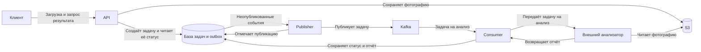

# Архитектура ImageAnalyzerS3

Редактируемая [схема системы в формате draw.io](ImageAnalyzerS3.drawio).

## Поток данных

1. **Загрузка.** Клиент отправляет фотографию через `POST /api/analyze`. API сохраняет её в S3, создаёт задачу со ссылкой на объект и статусом `created`. При успешной записи задачи API возвращает `202 Accepted` и её ID. При ошибке записи в БД возвращает `500 Internal Server Error`.
2. **Публикация.** Publisher читает неопубликованные события из outbox и отправляет их в Kafka. После подтверждения от брокера Publisher записывает `published_at` и фиксирует транзакцию в БД.
3. **Анализ.** Consumer читает задачу из Kafka и передаёт её внешнему анализатору, который получает фотографию из S3. При запуске анализа Consumer обновляет статус в БД. Получив отчёт, Consumer сохраняет его со статусом `finished`.
4. **Получение результата.** По `GET /api/analyze/{id}` API читает статус задачи из БД. Для завершённой задачи схема предусматривает два варианта ответа — отчёт в том же ответе или перенаправление на `/api/results/{id}`.

В схеме указаны два варианта имени промежуточного статуса — `processing` и `analyzing`. Имя статуса и формат ответа для завершённой задачи предстоит закрепить в контракте API.
