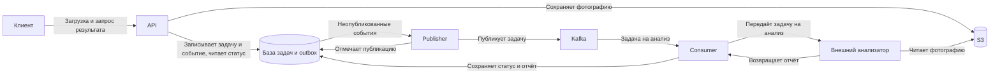

# Архитектура ImageAnalyzerS3

Редактируемая [схема системы в формате draw.io](ImageAnalyzerS3.drawio).



## Поток данных

1. **Загрузка.** Клиент отправляет фотографию через `POST /api/analyze`. API сохраняет её в S3, в одной транзакции записывает задачу и событие outbox, затем возвращает ID задачи. [Контракт загрузки](#post-apianalyze).
2. **Публикация.** Publisher читает неопубликованные события из outbox и отправляет их в Kafka. После подтверждения от брокера Publisher записывает `published_at` и фиксирует транзакцию в БД.
3. **Анализ.** Consumer читает задачу из Kafka и передаёт её внешнему анализатору, который получает фотографию из S3. При запуске анализа Consumer обновляет статус в БД. Получив отчёт, Consumer сохраняет его со статусом `finished`.
4. **Получение результата.** По `GET /api/analyze/{id}` API читает статус задачи из БД. Для завершённой задачи схема предусматривает два варианта ответа — отчёт в том же ответе или перенаправление на `/api/results/{id}`.

В схеме указаны два варианта имени промежуточного статуса — `processing` и `analyzing`. Имя статуса и формат ответа для завершённой задачи предстоит закрепить в контракте API.

## Объектное хранилище

Для первой локальной интеграции предлагается Garage на одном узле. Он поддерживает `PutObject` для загрузки, `GetObject` для чтения анализатором, `DeleteObject` для компенсации и `ListObjectsV2` для фоновой сверки. [Совместимость Garage с S3](https://garagehq.deuxfleurs.fr/documentation/reference-manual/s3-compatibility/).

Go-сервис обращается к хранилищу через S3 API. Для Garage клиент получает адрес через `BaseEndpoint`, использует адресацию `UsePathStyle` и подписывает запросы с регионом из `s3_region`. Имя бакета и учётные данные передаются при запуске. [Настройка endpoint в AWS SDK for Go v2](https://docs.aws.amazon.com/sdk-for-go/v2/developer-guide/configure-endpoints.html).

Первый сценарий можно проверить без PostgreSQL и Kafka. Клиент сохраняет тестовую фотографию через `PutObject`, читает её через `GetObject` и сравнивает содержимое с исходным файлом. Одноузловой Garage подходит для такой проверки, развёртывание с репликацией проектируется отдельно. [Быстрый старт Garage](https://garagehq.deuxfleurs.fr/documentation/quick-start/).

## Подключение к PostgreSQL

API читает `postgres_dsn` из YAML-конфигурации. Compose задаёт `POSTGRES_DSN` для подключения по адресу `postgres:5432`. При запуске API на хосте в DSN указывают `127.0.0.1` и порт из `POSTGRES_PORT`. [Локальный запуск API](../README.md#локальный-запуск-api).

## POST /api/analyze

Запрос передаёт одну фотографию в единственном файловом поле `image` с типом тела `multipart/form-data`. API принимает JPEG и PNG и проверяет содержимое файла декодированием. Максимальный размер файла — 10 МиБ, максимальный размер тела запроса вместе со служебными частями multipart — 11 МиБ. До декодирования API проверяет разрешение изображения. По умолчанию допустимо до 16 миллионов пикселей.

В `config/local.yaml` задаются лимиты в байтах и пикселях.

```yaml
http:
  max_file_bytes: 10485760
  max_request_bytes: 11534336
  max_image_pixels: 16000000
```

| Ответ | Условие |
| --- | --- |
| `202 Accepted` | Изображение сохранено в S3 и БД подтвердила фиксацию транзакции. В этой транзакции записаны задача со статусом `created` и ключом объекта в S3, а также событие в outbox. В теле ответа API возвращает `task_id`. |
| `400 Bad Request` | Некорректная multipart-форма, отсутствующий или пустой файл `image`, лишний файл, неподдерживаемый формат, повреждённое изображение или превышение лимита пикселей. |
| `413 Content Too Large` | Размер изображения превышает 10 МиБ или размер тела запроса превышает 11 МиБ. |
| `500 Internal Server Error` | Сохранение в S3 завершилось ошибкой или API не получил подтверждение фиксации транзакции БД. |

Ответ `202` имеет тип `application/json`.

```json
{"task_id": "<идентификатор задачи>"}
```

Этот `task_id` используется в `GET /api/analyze/{id}`. Publisher отправляет событие в Kafka асинхронно, после фиксации транзакции.

### Очистка объекта в S3 после ошибки БД

- Если откат транзакции подтверждён, API сразу пытается удалить фотографию из S3 вызовом `DeleteObject` с коротким таймаутом.
- Если исход `COMMIT` неизвестен или попытка удаления завершилась ошибкой, объект оставляют для фоновой сверки с БД.
- Фоновая очистка проверяет уникальный ключ объекта в основной БД после истечения окна, в котором задача ещё может быть записана. Объект удаляют только при подтверждённом отсутствии записи с этим ключом. Если БД недоступна, проверку повторяют позже.

### Таблицы `tasks` и `outbox`

Предлагаемая схема для PostgreSQL. API создаёт задачу и событие запуска анализа в одной транзакции.

| Поле `tasks` | Тип и ограничения | Назначение |
| --- | --- | --- |
| `id` | `UUID PRIMARY KEY` | ID задачи, который API возвращает клиенту. |
| `object_key` | `TEXT NOT NULL UNIQUE` | Ключ объекта в S3. Используется при анализе и фоновой сверке. |
| `status` | `VARCHAR NOT NULL DEFAULT 'created'` | Текущее состояние задачи. Допустимые значения закрепим в `CHECK` после согласования жизненного цикла. |
| `created_at` | `TIMESTAMPTZ NOT NULL DEFAULT CURRENT_TIMESTAMP` | Время создания задачи. |

| Поле `outbox` | Тип и ограничения | Назначение |
| --- | --- | --- |
| `id` | `UUID PRIMARY KEY` | Стабильный `event_id` сообщения в Kafka. |
| `task_id` | `UUID NOT NULL UNIQUE`, внешний ключ на `tasks.id` | Одна запись о запуске анализа на задачу. |
| `created_at` | `TIMESTAMPTZ NOT NULL DEFAULT CURRENT_TIMESTAMP` | Время создания события для сортировки и измерения задержки публикации. |
| `published_at` | `TIMESTAMPTZ`, допускает `NULL` | `NULL` означает, что подтверждение публикации ещё не зафиксировано. Publisher заполняет поле после подтверждения от Kafka. |

Publisher выбирает строки с `published_at IS NULL` в порядке `(created_at, id)`. Для этой выборки подходит частичный индекс по `(created_at, id)` с условием `published_at IS NULL`. В Kafka достаточно передать `event_id` и `task_id`. Consumer читает `object_key` из `tasks`.

Если Kafka подтвердила приём, а Publisher не успел сохранить `published_at`, он может отправить то же событие повторно. При повторной публикации `event_id` сохраняется. Consumer обрабатывает повторные доставки идемпотентно по этому ID.

При проектировании Consumer добавим `started_at` и `finished_at`, чтобы измерять время ожидания от `created_at` до старта и длительность анализа от старта до завершения.
